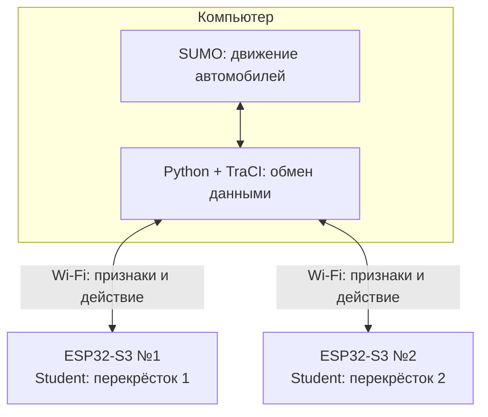
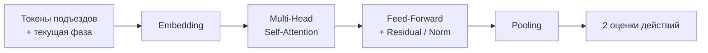
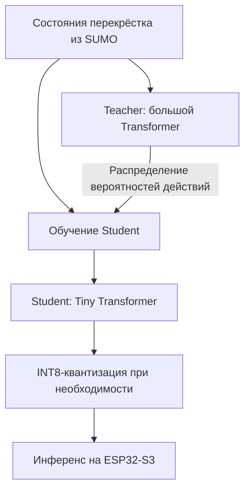
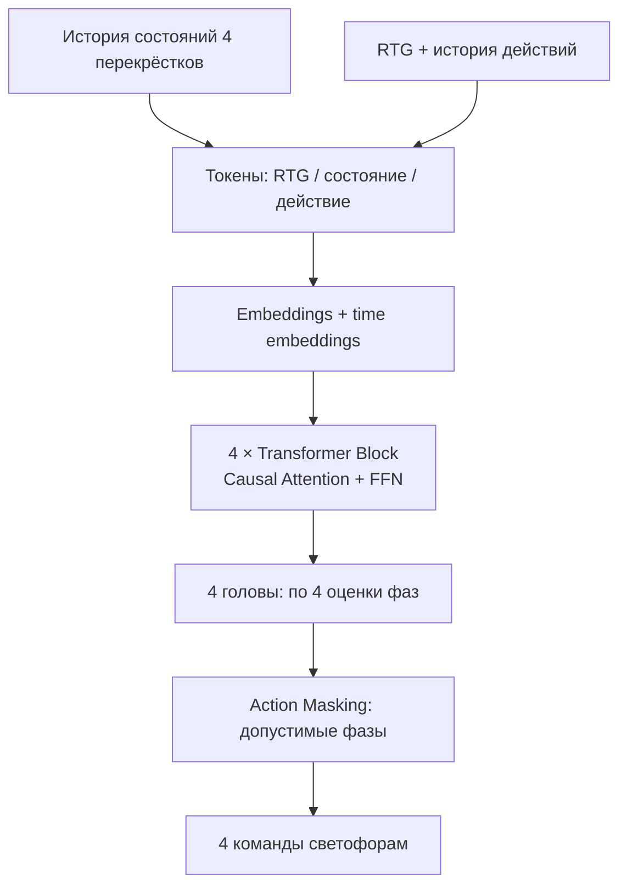
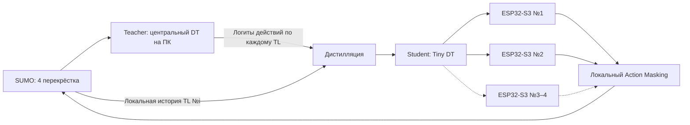

# Дистилляция RL-политик для управления светофорами на ESP32-S3
## 0. Описание задачи
Перенести политику управления светофором с компьютера на микроконтроллер и проверить, насколько меняются скорость и качество работы.

## 1. Выбор модели и контекст применения

**Задача:** управлять светофорами в сети из **2–4 перекрёстков**, сокращая очереди и время ожидания автомобилей.

- **Модель:** RL-политика с **Transformer Encoder**. Большая модель (**Teacher**) принимает решения; компактная (**Student**) учится их воспроизводить.
- **Сценарий:** обучение и дистилляция — **офлайн на компьютере**; применение Student — **онлайн, на ESP32-S3**.
- **Вход:** набор токенов, описывающих подъезды к перекрёстку: число машин, длину очереди, ожидание, занятость полос. Текущая светофорная фаза добавляется как общий признак.
- **Выход:** два действия — **сохранить фазу** или **запросить переключение**. Минимальная длительность зелёного и промежуточные сигналы задаются правилами контроллера.
- **Нагрузка:** одно решение на устройство через заданный интервал (например, каждые 5 секунд симуляции).

Важно, что конкретный предобученный **Transformer Teacher пока не выбран**

## 2. Целевая аппаратная платформа

**ESP32-S3** — отдельный микроконтроллер для каждого перекрёстка.

- **На компьютере:** SUMO, состояние всей дорожной сети, обмен данными, сбор метрик.
- **На микроконтроллере:** только инференс Student; симуляция и обучение на него не переносятся.
- **Ограничения:** RAM для активаций, Flash для весов и прошивки, производительность CPU, задержки Wi-Fi и энергопотребление.

## 3. Архитектура модели

**Transformer Encoder** позволяет учитывать взаимное влияние подъездов к перекрёстку с помощью **self-attention**.

| Компонент | Teacher (проектный вариант) | Student (проектный вариант) |
|---|---|---|
| Вход | 4 токена подъездов + общие признаки | Тот же формат |
| Transformer Encoder | 2 слоя | 1 слой |
| `d_model` | 128 | 32 |
| Attention heads | 4 | 2 |
| FFN (`d_ff`) | 256 | 64 |
| Выход | 2 оценки действий | 2 оценки действий |
| Устройство | ПК | ESP32-S3 |

Размерности приведены **как исходная конфигурация для эксперимента**, а не как характеристики готового checkpoint.

**Дистилляция:** Student обучается на состояниях из SUMO минимизировать расхождение с вероятностями действий Teacher.

Одна версия Student может использоваться на всех устройствах; решения принимаются **локально**, по состоянию своего перекрёстка.

## 3. Архитектура модели

**Выбранный Teacher:** [Safe-Offline-RL — Decision Transformer](https://github.com/Safe-ATSC-Project/Safe-Offline-RL). Это **централизованная** модель для 4 перекрёстков, обученная по историческим траекториям (offline RL) с возможностью online fine-tuning. В отличие от обычного Transformer Encoder, она предсказывает действие по **истории состояний, действий и Return-to-Go (RTG)**.

### Teacher: параметры из репозитория

| Параметр | Значение |
|---|---|
| Наблюдение | 4 перекрёстка × 25 признаков = **100** |
| Действия | **4 фазы на перекрёсток**, 4 независимые выходные головы |
| Контекст | `K = 20` шагов истории |
| Токены | `(RTG, state, action)` на каждом шаге → **60 токенов** |
| Transformer | **4 блока**, `d_model=128`, **4 attention heads**, `d_inner=512` |
| Механизмы | Causal self-attention, LayerNorm, GELU, residual connections |
| Размер | **1 271 696 параметров** ≈ **4,85 MiB** весов в FP32 |

Локальное наблюдение (25 признаков): плотности и средние скорости на 8 полосах, текущая фаза (one-hot, до 8 значений), время в фазе. **RTG** — целевой будущий суммарный reward; в конфигурации исходного проекта `target_return=-50.0`.

**Безопасность вынесена за пределы нейросети:** `Action Masking` ограничивает действия по `min_green=5 c`, `min_intergreen=3 c` и `max_consecutive_red=120 c`. В проекте также есть отдельный модуль координации соседних перекрёстков (green wave).

### Student: проектируемый Tiny Decision Transformer

Для каждого ESP32-S3 предлагается **одна и та же компактная модель**, использующая **только локальное наблюдение и его историю**.

| Параметр | Teacher | Student (план) |
|---|---:|---:|
| Перекрёстков на один инференс | 4 | 1 |
| Признаков состояния | 100 | 25 |
| История (`K`) | 20 | 8 |
| Токенов (`3K`) | 60 | 24 |
| Transformer blocks | 4 | 1 |
| `d_model` / attention heads | 128 / 4 | 32 / 2 |
| `d_inner` (FFN) | 512 | 64 |
| Выход | 4 × 4 фазы | 4 фазы |
| Параметры | 1 271 696 | ≈ 10 084* |

\* **Расчёт для предложенной архитектуры**, не результат обучения: embedding времени сокращён до `K=8` относительных позиций. При сохранении таблицы из 3600 позиций модель была бы существенно больше. Конфигурация Student и её запуск на ESP32-S3 ещё требуют проверки.

**Процесс обучения:** записываем траектории SUMO, получаем оценки четырёх фаз от Teacher для каждого перекрёстка и обучаем Student по локальной истории — через KL-divergence по распределению допустимых действий и, при необходимости, cross-entropy по действиям. Затем тестируем политику **в замкнутом цикле**, а не только по совпадению предсказаний.

> **Важное отличие:** Teacher видит все 4 перекрёстка, Student — только свой, поэтому часть решений Teacher невозможно точно восстановить из локальной информации; это отдельный источник потери качества. При необходимости добавим краткие сообщения от соседних контроллеров.

## 4. Вычислительные затраты и узкие места 

| Узкое место | Причина именно в Decision Transformer | Что измеряем |
|---|---|---|
| **История из 60 токенов** | Causal attention строит матрицу `60×60` для каждой головы; затраты растут примерно как `O((3K)²)` по памяти внимания | Пиковая RAM, время attention |
| **4 Transformer-блока и FFN** | Матричные умножения `Q/K/V`, выходных проекций и `128→512→128` | Latency по слоям, FLOPs |
| **Time embeddings** | Таблица `3600×128` содержит **460 800 параметров** (≈ 36% Teacher), хотя код обучения использует относительные позиции в окне | Размер весов / Flash |
| **LayerNorm, Softmax, GELU** | Не все операции имеют оптимизированные реализации для ESP32-S3 | Поддержка inference runtime, latency |
| **Ввод/вывод и синхронизация** | SUMO/TraCI, Wi-Fi, обновление окна истории и Action Masking | Полный цикл «состояние → действие» |

## 5. Системные ограничения

- **RAM / Flash:** веса, история из `3K` токенов, Q/K/V и промежуточные активации должны помещаться на ESP32-S3.
- **Задержка:** решение и проверка Action Masking должны завершаться до следующего шага управления.
- **Операции:** для Tiny DT необходимы Linear, causal attention, Softmax, LayerNorm и GELU (либо их проверенные замены).
- **Безопасность:** переключения запрещены до завершения `min_green` и переходных интервалов; при ошибке устройства — безопасный fallback.
- **Распределённость:** каждый контроллер хранит **собственную историю**; глобальное состояние Teacher на устройстве недоступно.
- **RTG:** нужно явно задать доступный на устройстве целевой RTG и одинаково обрабатывать его при дистилляции и инференсе.

## 6. Гипотезы по ускорению

| Метод | Изменение | Зачем | Возможный риск |
|---|---|---|---|
| **Knowledge Distillation** | 4 блока, `d=128` → 1 блок, `d=32`; глобальная → локальная политика | Снизить число параметров и вычислений | Потеря качества из-за сжатия и отсутствия глобального контекста |
| **Сокращение истории** | `K: 20 → 8` (60 → 24 токена) | Снизить стоимость causal attention и RAM | Модель хуже учитывает длительные пробки |
| **Сокращение time embeddings** | `max_ep_len: 3600 → 8` для относительных позиций Student | Не хранить большую неиспользуемую таблицу | Требуется согласовать индексацию времени при обучении и инференсе |
| **INT8-квантизация** | Квантизовать поддерживаемые Linear/веса | Сократить Flash/RAM, возможно latency | Потери точности; Softmax/LayerNorm могут остаться float |
| **Оптимизация runtime** | Статические размеры буферов, сокращение копирований, оптимизация матричных операций | Уменьшить накладные расходы ESP32-S3 | Больше кода и сложнее поддержка |

**Гипотеза:** Tiny Decision Transformer, дистиллированный из Safe-Offline-RL Teacher, сможет выполнять локальный инференс на ESP32-S3 при приемлемом ухудшении транспортных метрик по сравнению с централизованной моделью.

**Процесс проверки:** сравнить Fixed-Time, Actuated, Teacher DT, Student на ПК и Student на ESP32-S3 в одинаковых сценариях SUMO. Измерить среднее время поездки/ожидания, очередь, throughput, нарушения безопасности, размер модели, RAM, Flash, время инференса и сквозную задержку.

## 7. Инженерные компромиссы

| Что выигрываем | Чем платим |
|---|---|
| От ≈ 1,27 млн параметров Teacher до ≈ 10 тыс. Student на устройство (по выбранным конфигурациям) | Меньше выразительность модели; разные масштабы наблюдения и действий |
| Меньший контекст (`K=8`) | Потеря дальних временных зависимостей |
| Локальный инференс без центрального сервера решений | Student не видит соседние перекрёстки без дополнительной связи |
| INT8 и компактные embeddings | Дополнительная разработка, проверка точности и операторов |
| Независимые ESP32-S3 | Сложнее синхронизация, отказоустойчивость и тестирование безопасности |

## Источники

- [Safe-Offline-RL: репозиторий Teacher](https://github.com/Safe-ATSC-Project/Safe-Offline-RL)
- [Реализация Decision Transformer](https://github.com/Safe-ATSC-Project/Safe-Offline-RL/blob/main/phase1/models/decision_transformer.py)
- [Конфигурация модели](https://github.com/Safe-ATSC-Project/Safe-Offline-RL/blob/main/configs/config.yaml)
- [Состояние перекрёстка и SUMO-среда](https://github.com/Safe-ATSC-Project/Safe-Offline-RL/blob/main/phase1/env/sumo_env.py)
- [Action Masking](https://github.com/Safe-ATSC-Project/Safe-Offline-RL/blob/main/phase2/safety/action_mask.py)

